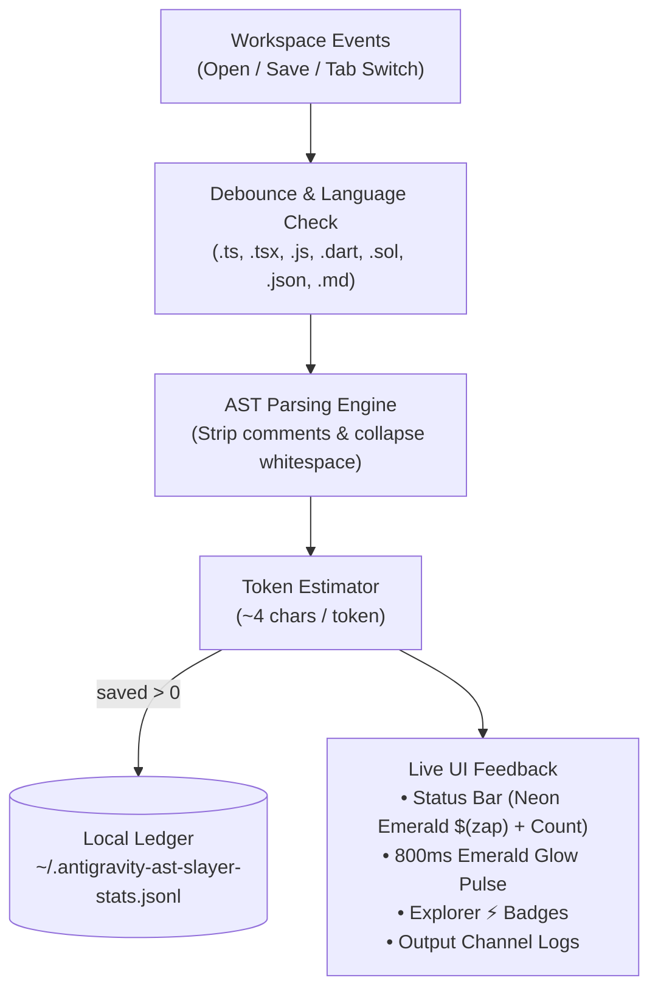
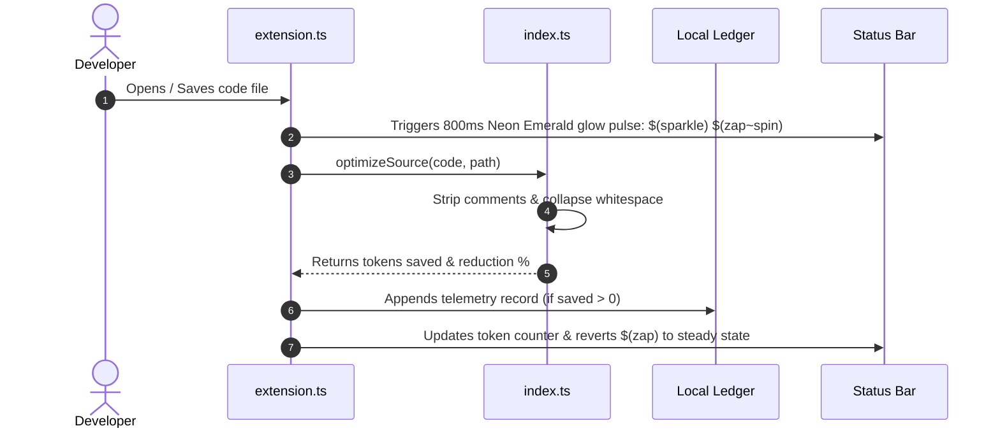

# AST Slayer — Architecture & Workflow

> **Zero-config background token optimization mirror for Antigravity IDE / VS Code.**

---

## 1. System Architecture

---

## 2. Core Components

| Component | File | Responsibilities |
|---|---|---|
| **Extension Host** | `src/extension.ts` | Listens to workspace events, drives status bar items, animates the Neon Emerald glow pulse, and registers explorer badges. |
| **AST Engine** | `src/index.ts` | Language detection, comment stripping (preserving string literals), whitespace collapsing, and token calculations. |
| **Local Ledger** | `~/.antigravity-ast-slayer-stats.jsonl` | Append-only JSON Lines store for cumulative telemetry and token savings. Zero network calls. |

---

## 3. Execution Lifecycle

---

## 4. Key Engineering Decisions

* **Dual Status Bar Anchoring:** Uses adjacent priorities (`99.1` for icon, `99.0` for text) strictly below built-in editor indicators (`100.1`–`100.5`) to keep the icon and counter locked side-by-side.
* **Codicon vs. Emoji:** Uses native VS Code `$(zap)` codicon instead of Unicode emoji `⚡` to allow `#00E676` (Neon Emerald) color rendering on Windows.
* **Non-Blocking Visual Pulse:** Minimum 800ms animation guarantee ensuring the background optimization is clearly visible without blocking the main editor thread.

---

## 5. Specifications & Benchmarks

* **VSIX Package Size:** ~11.6 KB (zero runtime dependencies)
* **Optimization Latency:** < 2.5 ms / file
* **Supported Languages:** TypeScript, TSX, JavaScript, Dart, Solidity, JSON, Markdown
* **Runtime Target:** Node 18+ ESM, bundled with `esbuild`
